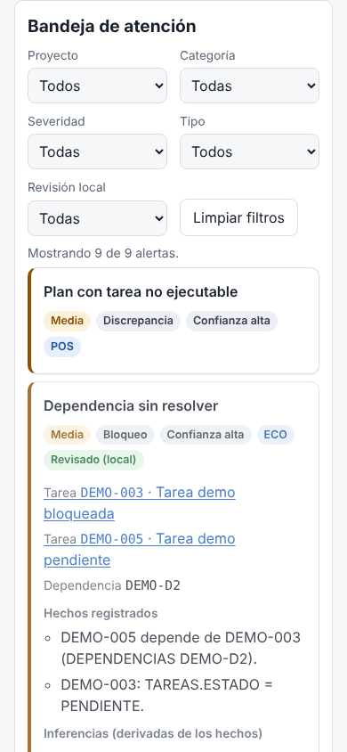
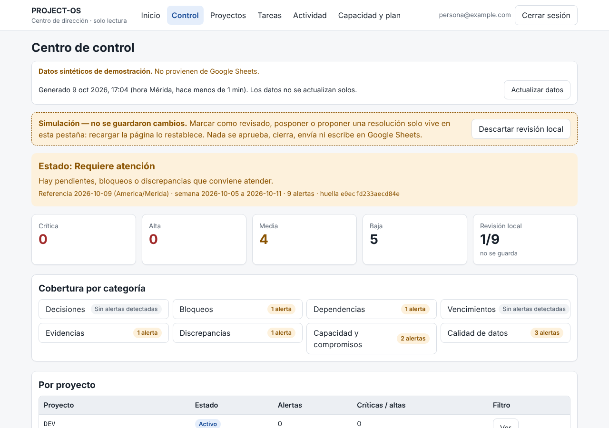

# PROJECT-OS V1.6 — Centro de control: guía de uso

> `/control` reúne en una bandeja lo que necesita atención:
> - decisiones pendientes;
> - bloqueos y dependencias sin resolver;
> - vencimientos;
> - evidencias por revisar;
> - discrepancias de datos;
> - compromisos sin capacidad.
>
> Explica cada alerta. **No aprueba, no cierra, no envía ni ejecuta nada**, y no escribe en Google Sheets.
>
> Reglas exactas: [`v1-6-governance-contract.md`](v1-6-governance-contract.md).

## 1. Cómo leer el panel

1. **Aviso "Simulación — no se guardaron cambios".** Todo lo que marques (revisado, pospuesto, resolución
   propuesta) vive solo en esta pestaña. Recargar la página lo restablece.
2. **Estado global:**
   - **Crítico:** algo impide operar o verificar.
   - **Requiere atención:** hay alertas altas o medias.
   - **Datos incompletos:** faltan pestañas.
   - **Revisiones sugeridas:** solo hay alertas bajas.
   - **Sin alertas detectadas:** no hay nada que señalar con los datos disponibles. **Nunca significa "todo bien".**
3. **Severidad** (crítica, alta, media, baja): pulsa una tarjeta para filtrar.
4. **Cobertura por categoría.** Cada categoría dice si tiene alertas, si no se detectó ninguna o si está **sin
   datos suficientes** (falta una pestaña). Nunca aparece un falso verde.
5. **Por proyecto:** cuántas alertas tiene cada uno y cuántas son críticas o altas. Muestra los proyectos
   inactivos y los no registrados.
6. **Bandeja de atención:** filtros por proyecto, categoría, severidad, tipo y estado de revisión local. Cada
   alerta se despliega con:
   - **Hechos registrados:** los valores tal cual están en Sheets.
   - **Inferencias:** lo que se deriva de esos hechos sin margen de duda (por ejemplo, "vencida hace 8 días").
   - **Hipótesis:** riesgos posibles; no son hechos.
   - **Acción sugerida (no ejecutada):** lo que una persona podría hacer en Sheets o en GitHub.
   - **Entidades:** enlaces internos a la tarea (`/tareas?q=ID`), al proyecto, o a los hitos, decisiones y
     evidencias del proyecto, y a la capacidad.
   - **Confianza:** alta, media o baja. Una alerta de confianza baja (por ejemplo, "tarea completada sin
     evidencia") es una **revisión sugerida**, no un incumplimiento.
7. **Enlace directo:** `/control?alerta=<id>` abre esa alerta. El ID es estable y solo contiene la regla y un hash.

## 2. Revisión local (simulada)

| Acción | Efecto | Lo que NO hace |
| --- | --- | --- |
| Marcar revisado | La alerta queda como "Revisado (local)" | No la resuelve ni la oculta para otros |
| Posponer… | "Pospuesto (local) hasta FECHA" | No crea recordatorios ni notificaciones |
| Proponer resolución… | Guarda un borrador de texto en la pestaña | No lo envía, no lo guarda, no lo aplica |
| Deshacer | Vuelve a pendiente | — |
| Descartar revisión local | Limpia todo lo marcado | — |

**Una decisión registrada no autoriza nada.**

- `APROBADA` en `DECISIONES` no habilita merges, despliegues, escrituras reales, gasto ni cambios de
  infraestructura.
- Esas autorizaciones son externas y deben ser explícitas, específicas y verificables (contrato, §6.3).

## 3. API de solo lectura

`GET /api/control` requiere sesión autorizada. Devuelve:

```
{ soloLectura, aviso, fuente, filtros, totalSinFiltros, informe }
```

| Parámetro | Valores |
| --- | --- |
| `proyecto` | ID de proyecto o `sin-proyecto` |
| `categoria` | `decisiones`, `bloqueos`, `dependencias`, `vencimientos`, `evidencias`, `discrepancias`, `capacidad`, `datos` |
| `severidad` | `critica`, `alta`, `media`, `baja`, `info` |
| `tipo` | `incumplimiento`, `discrepancia`, `bloqueo`, `pendiente`, `riesgo`, `revision`, `diagnostico` |
| `fecha` | `YYYY-MM-DD` (referencia; por defecto, hoy en Mérida) |

Reglas de la API:

- **Parámetro desconocido, repetido o inválido ⇒ 400** con `campo`.
- **No hay POST, PUT, PATCH ni DELETE** (405).
- **Respuesta:** `Cache-Control: no-store`.
- **Minimización:** la respuesta **no contiene texto libre de la hoja** (títulos, notas, bloqueos, texto de
  decisiones) ni correos. Solo IDs, códigos, fechas y números.
- **Errores:** si la fuente falla, devuelve 503 sin datos parciales.

## 4. Integración futura (no realizada)

- **V1.5 (planificador, PR #10):** el motor acepta señales opcionales `planificacion: { semanaIso, conflictos }`,
  con la misma forma que `PlanResult.conflictos`.
  - Tras fusionar #10, `/control` puede pasar `planWeek(...).conflictos` a `governanceInputFromDataset(data, señales)`.
  - Es **una línea**, sin copiar código. Las alertas resultantes se marcan como "señal de una propuesta simulada".
- **V1.4 (operaciones, PR #8):** "Proponer resolución" podría convertirse, en una misión autorizada, en un
  borrador de operación V1.4 (por ejemplo, editar el estado o el bloqueo de una tarea).
  - Pasaría por la auditoría primero, la validación, la idempotencia y los permisos de escritor de V1.4, con
    confirmación humana.
  - El panel seguiría sin escribir por sí solo.
- **Aprobaciones formales:** una pestaña `APROBACIONES` futura, que requiere migración aprobada (contrato, §6.2).
- **Detalle de decisiones:** hoy se enlaza a `/proyectos/ID#decisiones`. Una vista propia de decisión puede
  añadirse cuando exista.

## 5. Pruebas

```bash
cd web
npm test                    # unitarias, propiedades (300 casos) y seguridad
npm run build
npm run test:e2e:control    # E2E HTTP: acceso, solo lectura, filtros, validación, minimización, errores
```

En CI, las unitarias corren en `web-validation.yml` y el E2E en `control-validation.yml`, sin secretos y sin
contactar Sheets.

## 6. Capturas (datos sintéticos)

| Móvil | Escritorio |
| --- | --- |
|  |  |
