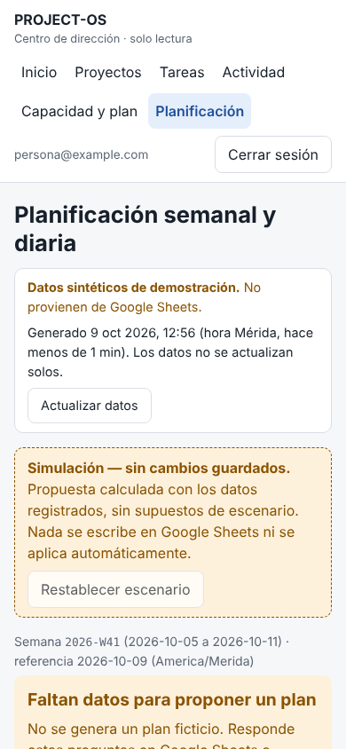
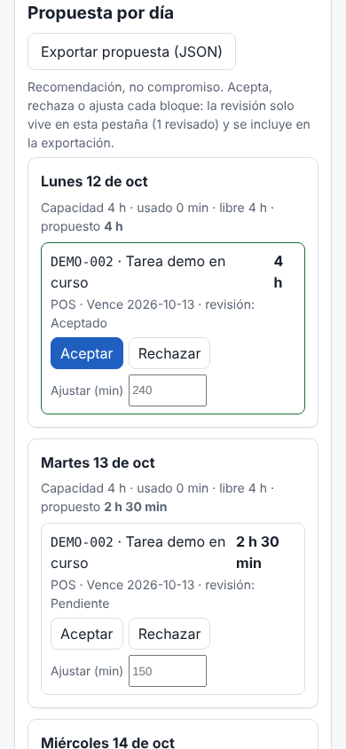
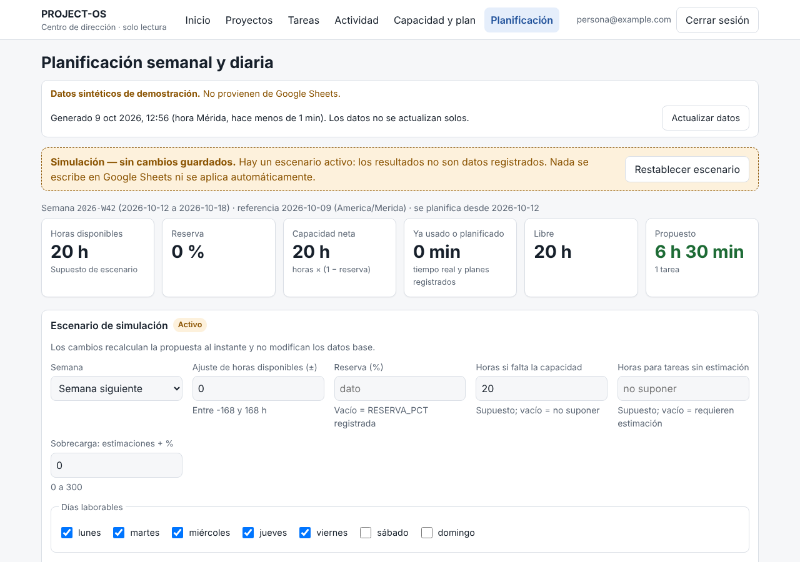

# PROJECT-OS V1.5 — Planificación semanal y diaria: guía de uso

> **Propuestas, no compromisos.** La pantalla `/planificacion` recomienda qué hacer esta semana y en qué orden,
> y explica por qué.
>
> Lo que **no** hace:
> - escribir en Google Sheets;
> - guardar escenarios ni revisiones;
> - aplicar nada por sí sola.
>
> Las reglas exactas están en [`v1-5-planning-contract.md`](v1-5-planning-contract.md).

## 1. Qué muestra

1. **Aviso permanente "Simulación — sin cambios guardados"** y el botón **Restablecer escenario**.
2. **Diagnóstico.** Si faltan datos (por ejemplo, la semana sin `HORAS_DISPONIBLES`), no hay plan ficticio: se
   muestran preguntas concretas y la opción de simular capacidad, marcada como supuesto.
3. **Capacidad de la semana:**
   - horas disponibles y su origen (dato, supuesto, faltante o ambiguo);
   - reserva y capacidad neta;
   - lo ya usado o planificado;
   - lo libre y lo propuesto.
4. **Escenario de simulación:**
   - semana actual o siguiente;
   - ± horas;
   - reserva %;
   - capacidad supuesta;
   - estimación supuesta;
   - sobrecarga;
   - días laborables;
   - prioridad simulada por proyecto;
   - descontar tiempo registrado.
5. **Propuesta por día:**
   - bloques ordenados con minutos y motivo corto ("Vencida", "Vence 2026-10-09", "Desbloquea 2", "Prioridad ALTA");
   - en cada bloque, **Aceptar**, **Rechazar** o **Ajustar (min)**.
6. **Reparto por proyecto:** prioridad y peso, asignación (`ASIGNACIONES`), uso, demanda y propuesto.
7. **Tareas candidatas y excluidas**, con filtros. Cada tarea despliega su **explicación**: por qué se recomienda,
   cuánto tiempo se le asigna, qué falta y por qué se excluye.
8. **Preguntas y conflictos:** lo que el motor no puede decidir y los datos contradictorios.

Funciona en celular (390 px) y en escritorio, sin desplazamiento horizontal, con etiquetas accesibles y errores
anunciados (`aria-invalid` y `role="alert"`).

## 2. Cómo se calcula (resumen)

- **Capacidad neta** = horas disponibles × (1 − reserva).
  - Se reparte por igual entre los días laborables de la semana.
  - Un plan diario registrado con `HORAS_OBJETIVO` fija la capacidad de su día.
  - La capacidad no usada de días pasados no se traslada.
- **Uso:** el tiempo real de los días pasados y, desde hoy, `máx(plan registrado, real)` por día y proyecto. Nunca
  se descuenta dos veces.
- **Elegibles:** tareas abiertas, sin bloqueo, con prerrequisitos `COMPLETADO`, con estimación y de un proyecto
  activo.
- **Orden:** vencidas → vencen esta semana → prioridad → desbloquea más → en curso → límite → ID.
- **Reparto entre proyectos:** urgencia → piso de 60 min por proyecto → proporción por peso (ALTA 3, MEDIA 2,
  BAJA 1). Las `ASIGNACIONES` registradas son límites duros.
- **Días:** como máximo 3 h por tarea y día mientras haya alternativas, y sin fragmentos menores de 30 min.

## 3. Supuestos que el motor no hace por su cuenta

| Situación | Comportamiento por defecto | Escenario opcional (marcado como supuesto) |
| --- | --- | --- |
| Semana sin horas disponibles | Diagnóstico y pregunta; no hay plan | "Horas si falta la capacidad" |
| Tarea sin estimación | Excluida y "requiere estimación manual" | "Horas para tareas sin estimación" |
| Tiempo registrado en una tarea | **No** se descuenta (el tiempo no equivale a avance) | "Descontar el tiempo registrado" |
| Prioridad desconocida | Después de `BAJA`, con aviso | Prioridad simulada por proyecto |
| `RESERVA_PCT` vacía | 0 %, declarado en "Supuestos" | "Reserva (%)" |

## 4. Revisión y exportación (solo local)

- **Revisión:** aceptar, rechazar o ajustar vive **solo en la pestaña del navegador**. Recargar la página,
  cambiar el escenario o pulsar "Restablecer escenario" la descarta.
- **Exportar propuesta (JSON):** descarga un archivo en el dispositivo con el esquema
  `project-os.planificacion.propuesta/v1`.
  - **Contiene:** IDs de tarea y proyecto, fechas, minutos, decisiones, escenario, supuestos y la huella de entrada.
  - **No contiene:** títulos, nombres, correos ni notas.
  - **No se aplica** en ningún lugar.
- **Mover tareas entre días (ORD-POS-137):** cada bloque de «Propuesta por día» se arrastra a otro día (arrastre HTML
  nativo) o se mueve con su selector «Mover a…» (teclado y celular). El movimiento vive en el escenario como
  `fijadas` (tarea → fecha `AAAA-MM-DD`, máximo 200): el motor coloca primero cada fijada, con todo su objetivo semanal,
  en su día y recalcula el resto; la capacidad de cada día cambia al instante. Un día que queda por encima de su hueco,
  un movimiento antes de `FECHA_PLAN` («antes de su FECHA_PLAN») o fuera de los días que quedan se informan como
  conflicto; nunca se recortan en silencio. La tarjeta movida lleva borde punteado y la marca «Simulado»; el aviso dice
  «N movimientos sin guardar» solo cuando los hay, y «Descartar movimientos» los quita. **No se guardan** en la hoja.
  Con `fijadas` vacío o ausente el resultado y la huella son idénticos a los de antes.
- **Esquema v2 de la exportación:** sin movimientos se exporta `project-os.planificacion.propuesta/v1`, sin cambios.
  Con movimientos se exporta `project-os.planificacion.propuesta/v2` = v1 más `escenario.fijadas` (tarea → fecha) y
  `fijada: true` en cada elemento de una tarea movida. Tampoco lleva títulos, nombres, correos ni notas.

## 5. API de solo lectura

`GET /api/planificacion` (requiere sesión autorizada) devuelve `{ simulacion: true, aviso, fuente, escenario, plan }`.

| Parámetro | Ejemplo |
| --- | --- |
| `fecha` | `2026-10-09` (por defecto, hoy en Mérida) |
| `semana` | `actual` / `siguiente` |
| `ajusteHoras`, `reservaPct`, `horasSiFaltan`, `horasSiSinEstimacion`, `sobrecargaPct` | `reservaPct=10` |
| `diasLaborables` | `1,2,3,4,5,6` |
| `descontarRegistrado` | `true` |
| `prioridad.<PROYECTO>` | `prioridad.SIG=ALTA` |

Reglas de la API:

- **Parámetro desconocido, repetido o fuera de rango ⇒ 400** con `campo`.
- **No hay POST, PUT, PATCH ni DELETE** (405).
- **Respuesta:** `Cache-Control: no-store`.
- **Datos:** la respuesta no incluye responsables, descripciones, notas ni correos.

## 6. Integración futura con V1.4 (no conectada)

V1.4 (PR #8, abierto) añade operaciones de escritura simuladas con auditoría. Esta versión **no** las usa. Deja
preparados los siguientes puntos de extensión:

- **`acceptedDrafts(exportación)`** (`web/src/lib/planning/export.ts`):
  - convierte los bloques aceptados o ajustados en borradores con forma de `PLAN_ITEMS` (`fecha`, `tareaId`,
    `orden`, `minutosPlan`);
  - **no asigna IDs ni escribe**.
- **`PlanResult.huella`:** permite comprobar, antes de aplicar, que la propuesta revisada corresponde a los datos
  actuales. Si los datos cambiaron, la huella cambia y habría que recalcular.

Plan propuesto, que **requiere autorización expresa**:

1. Después de fusionar #8, añadir en el servicio de operaciones las operaciones `plan.crear` y `plan-item.crear`,
   con la misma validación, auditoría primero, idempotencia y permisos de escritor.
2. Añadir el botón "Aplicar propuesta aceptada", visible solo para escritores y con confirmación explícita:
   - envía los borradores y la huella;
   - el servidor recalcula la propuesta y rechaza la operación si la huella no coincide (409).
3. Mantener la regla actual: el motor nunca cierra tareas ni crea `PLAN_DIARIO` por su cuenta.

## 7. Casos límite cubiertos por pruebas

- Capacidad 0, reserva del 100 %, ajuste que deja horas negativas.
- Semana sin fila, con filas ambiguas o con `FECHA_INICIO` que no es lunes.
- Sobrecarga, asignaciones que exceden la capacidad y asignaciones duplicadas.
- Planes que exceden la capacidad y días sobreasignados.
- Proyectos múltiples con piso anti-inanición; prioridades desconocidas.
- Tareas vencidas o con límite que no cabe; sin estimación (con y sin supuesto).
- Tareas bloqueadas, cerradas, sin estado o con ID duplicado.
- Proyecto ausente, inexistente o inactivo.
- Dependencias:
  - pendientes, inactivas, inexistentes, duplicadas o incompletas;
  - de tareas cerradas;
  - con prerrequisito cancelado;
  - ciclos (incluida la autodependencia).
- Tiempo registrado con y sin descuento, y la estimación agotada.
- `FECHA_PLAN` dentro y fuera de la semana.
- Semana siguiente y días laborables personalizados.
- Zona horaria: domingo 23:30 en Mérida = lunes en UTC.
- Semanas ISO en el cambio de año.
- Reproducibilidad, desempates, filas barajadas, no mutación y entrada vacía.
- 400 casos aleatorios con invariantes.

## 8. Ejecutar las pruebas

```bash
cd web
npm test                    # unitarias, de propiedades y de seguridad (incluye planificación)
npm run build
npm run test:e2e:planning   # E2E HTTP: acceso, solo lectura, validación, determinismo, minimización
```

## 9. Capturas (datos sintéticos)

| Diagnóstico sin capacidad (móvil) | Propuesta revisada (móvil) | Escenario activo (escritorio) |
| --- | --- | --- |
|  |  |  |
