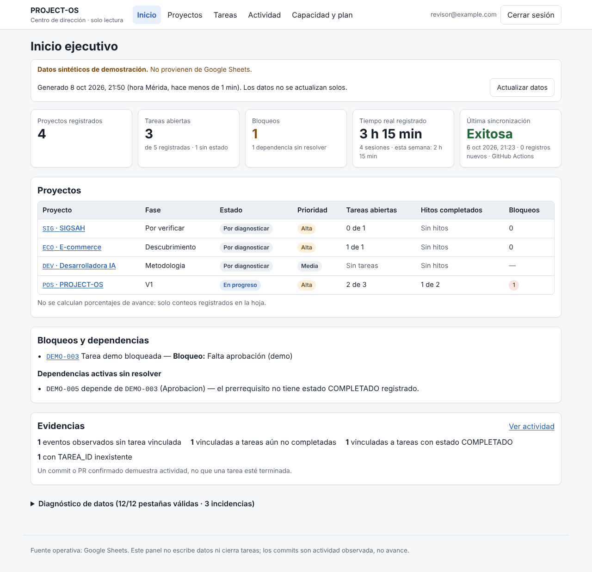
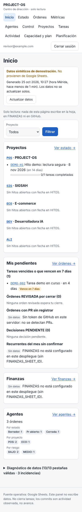
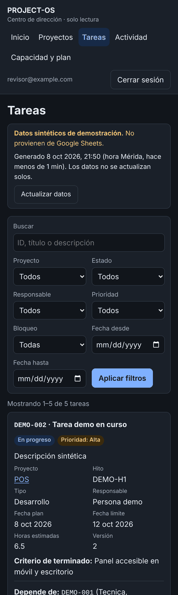

# PROJECT-OS V1.2 — Dashboard web (solo lectura)

Panel privado, usable en móvil y escritorio, que **lee** la Google Sheet operativa de PROJECT-OS.
No escribe en Sheets, no cierra tareas y no está publicado en internet: se ejecuta en **modo local/privado**
hasta que el usuario apruebe un hosting.

- **Stack:** Next.js 16 (App Router) + TypeScript, NextAuth v4 (Google OAuth), `google-auth-library`.
- **Datos:** Google Sheets API v4, cuenta de servicio, alcance `spreadsheets.readonly`, solo en el servidor.
- **Pantallas:** Inicio ejecutivo · Proyectos (lista y detalle) · Tareas (filtros) · Actividad · Capacidad y plan diario.

Decisiones técnicas, riesgos y límites: [`docs/decisiones-dashboard-v1-2.md`](../docs/decisiones-dashboard-v1-2.md).

## Requisitos

- Node.js ≥ 20.9 (probado con Node 22) y npm.
- Para datos reales: una cuenta de servicio con acceso de **Lector** a la hoja.
- Para iniciar sesión: un cliente OAuth de Google (tipo *Aplicación web*).

## Inicio rápido con datos sintéticos (sin credenciales de Google Sheets)

```bash
cd web
npm ci
cp .env.example .env.local
# Edita .env.local:
#   DASHBOARD_DATA_SOURCE=fixtures
#   NEXTAUTH_SECRET=<salida de: openssl rand -base64 32>
#   GOOGLE_CLIENT_ID / GOOGLE_CLIENT_SECRET  (ver "Autenticación")
#   AUTH_ALLOWED_EMAILS=tu-correo@dominio
npm run dev     # http://localhost:3000
```

El modo `fixtures` muestra una franja **"Datos sintéticos de demostración"** en todas las páginas.
Aun así exige iniciar sesión.

## Conexión con la Google Sheet real (solo lectura)

1. En Google Cloud, en un proyecto bajo tu control, habilita **Google Sheets API**.
2. Usa una **cuenta de servicio dedicada al dashboard** (recomendado) o la de V1.1. Para el dashboard basta con
   compartir la hoja como **Lector**; no compartirla por enlace público.
   - Aunque la cuenta tuviera permiso de Editor, el dashboard pide el alcance
     `https://www.googleapis.com/auth/spreadsheets.readonly` y solo emite peticiones `GET`.
3. Crea una clave JSON **solo si tu política lo permite** y guárdala **fuera del repositorio**, por ejemplo
   `~/.config/project-os/dashboard-sa.json` con permisos `600`.
4. En `web/.env.local`:
   ```
   DASHBOARD_DATA_SOURCE=sheets
   SHEETS_SPREADSHEET_ID=16UXe7fm90fOTTVJhI_RZ8__I876u2buvjeLGr5cJ-Ic
   PROJECT_OS_GOOGLE_SERVICE_ACCOUNT_FILE=/ruta/absoluta/fuera/del/repo/dashboard-sa.json
   ```
   (Alternativa en un hosting con gestor de secretos: `PROJECT_OS_GOOGLE_SERVICE_ACCOUNT_JSON` con el JSON completo.)
5. `npm run dev` y abre el **Diagnóstico de datos** al final del Inicio: las 12 pestañas deben aparecer como
   *Válido*. Si falta o cambia una columna, la pestaña se marca y sus datos se muestran como "no disponibles",
   nunca como cero.

## Autenticación

Autenticación real con **NextAuth v4 + Google OAuth** (no hay formularios de contraseña propios).

1. Google Cloud → *APIs y servicios* → *Pantalla de consentimiento OAuth*: tipo **Externo** en modo
   **Prueba** (o Interno si usas Workspace) y agrega tu correo como usuario de prueba.
2. *Credenciales* → *Crear ID de cliente OAuth* → **Aplicación web**.
   - Orígenes autorizados: `http://localhost:3000`
   - URI de redirección: `http://localhost:3000/api/auth/callback/google`
3. Copia el ID y el secreto a `GOOGLE_CLIENT_ID` y `GOOGLE_CLIENT_SECRET` en `.env.local`.
4. `NEXTAUTH_SECRET`: `openssl rand -base64 32`. `NEXTAUTH_URL=http://localhost:3000`.

### Política de usuarios y sesiones

- **Lista explícita** de correos en `AUTH_ALLOWED_EMAILS` (separados por coma, sin distinguir mayúsculas).
  Lista vacía ⇒ nadie entra.
- Google debe reportar el correo como **verificado** (`email_verified`).
- La lista se comprueba al iniciar sesión **y en cada petición** (proxy + cada página/API): quitar un correo
  revoca el acceso en la siguiente petición sin esperar a que caduque la sesión.
- Sesión en cookie **cifrada** (JWE, `httpOnly`, `SameSite=Lax`, `Secure` cuando `NEXTAUTH_URL` es https),
  duración máxima **8 h** (`AUTH_SESSION_MAX_AGE_SECONDS`, tope 7 días).
- Sin sesión válida: páginas → redirección a `/login`; `/api/resumen` → `401`; correo no permitido → `403`
  o `/login?error=AccessDenied`. Ninguna respuesta incluye datos de la hoja.

## Scripts

| Comando | Qué hace |
| --- | --- |
| `npm run dev` | Servidor de desarrollo. |
| `npm run build` / `npm start` | Build de producción y servidor local (`next start`). |
| `npm run lint` | ESLint (config de Next + TypeScript). |
| `npm run typecheck` | `tsc --noEmit` en modo estricto. |
| `npm test` | Pruebas unitarias (Vitest): parsing, fechas Mérida, conteos, vacíos, cliente Sheets, autorización de rutas, revisiones de seguridad. |
| `npm run test:e2e` | Requiere `npm run build`. Levanta `next start` con datos sintéticos y secretos aleatorios y comprueba, por HTTP real, que sin sesión válida ninguna página/API devuelve datos. |
| `npm run check:client-secrets` | Requiere `npm run build`. Busca claves, tokens, correos y los valores de las variables secretas del entorno en `.next/static`. |

En CI, `.github/workflows/web-validation.yml` ejecuta esta misma secuencia en cada PR que toca `web/`.

Validación completa antes de pedir revisión:

```bash
npm ci && npm run lint && npm run typecheck && npm test && npm run build \
  && npm run test:e2e && npm run check:client-secrets
```

## Datos: reglas de lectura

- Encabezados validados **por nombre exacto** (`src/lib/schema.ts`); el orden puede variar; columnas extra se ignoran.
- Celdas vacías ⇒ `null` ("Sin registrar", "Sin datos"); nunca se convierten en 0.
- Números: coma o punto decimal; textos o negativos se reportan como incidencia (sin mostrar el valor).
- Fechas `AAAA-MM-DD` = fecha civil; fechas con hora y zona se muestran en **hora de Mérida**; fecha-hora sin zona
  se interpreta como hora de Mérida; formatos ambiguos (`08/10/2026`) se marcan como inválidos.
- Hasta 5 000 filas por pestaña en una sola lectura `batchGet`; al superarlo se avisa que los totales pueden estar incompletos.
- Caché en memoria de 60 s (configurable, máx. 300 s). El botón **Actualizar datos** fuerza una relectura
  (como mucho una vez cada 10 s). No hay actualización en tiempo real.
- Estados: una tarea es *abierta* si su `ESTADO` no está vacío y no es `COMPLETADO`/`CANCELADO`.
  *Bloqueada* = abierta con `BLOQUEO` no vacío o `ESTADO=BLOQUEADO`. Las dependencias pendientes se muestran aparte.
- Evidencias: *evento observado* (sin `TAREA_ID`) ≠ *tarea validada* (vinculada a tarea con `COMPLETADO`
  registrado por una persona). `VERIFICACION=CONFIRMADO` solo confirma el evento en su fuente.

## Estructura

```
web/
  src/proxy.ts                 # barrera de autenticación (Next 16 "proxy", antes middleware)
  src/lib/schema.ts            # diccionario de datos exacto
  src/lib/parse.ts, dates.ts   # normalización de celdas, números y fechas (America/Merida)
  src/lib/table.ts             # validación de encabezados y mapeo tipado de filas
  src/lib/aggregate.ts         # conteos, bloqueos, tiempos, capacidad, filtros, paginación
  src/lib/sheets-client.ts     # cliente GET-only de Sheets API (server-only)
  src/lib/data.ts              # selección de fuente + caché corta (server-only)
  src/lib/auth.ts, access.ts, authz.ts  # NextAuth, lista de permitidos, decisión de acceso
  src/lib/fixtures.ts          # datos SINTÉTICOS (no es copia de la hoja real)
  src/app/(private)/…          # páginas privadas
  tests/                       # Vitest
  scripts/                     # e2e de autorización y revisión de secretos en assets
```

## Capturas (datos sintéticos)

| Escritorio | Móvil | Móvil (modo oscuro) |
| --- | --- | --- |
|  |  |  |

Más: [tareas en escritorio](docs/capturas/escritorio-tareas.png), [capacidad en móvil](docs/capturas/movil-capacidad.png),
[inicio de sesión](docs/capturas/movil-login.png).

## Fuera de alcance (V1.2 inicial)

Escritura/CRUD, auditoría de cambios, reglas de cierre `COMPLETADO`, planificador, despliegue en internet,
scheduling y cualquier segunda base de datos. Requieren aprobación del usuario.
